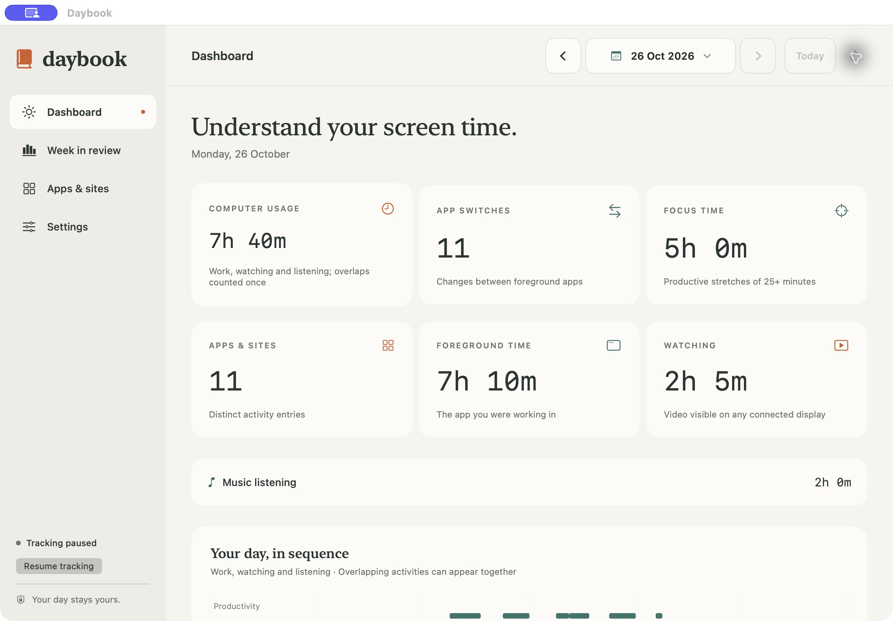

# Daybook

A private Mac dashboard for apps, websites, productivity, watching, music, app switches, and your daily timeline.



[Apps & sites](docs/images/apps-and-sites.jpg) · [Dark mode](docs/images/dark-mode.jpg)

Activity stays on your Mac. No telemetry, accounts, or activity uploads.

## Set up

Download the Apple-notarized app ZIP from [Releases](https://github.com/baymac/Daybook/releases), unzip it, then move Daybook to Applications. Requires Apple silicon and macOS 14+.

Or build with Xcode command line tools:

```sh
./build.sh
open .build/Daybook.app
```

Choose System, Light, or Dark appearance in **Settings**. Start tracking, then enable what you need:

- **Website domains:** allow browser Automation.
- **Install Daybook Helper:** download or use the included Brave/Chrome/Edge helper, connect, then load it in Extensions. Playback messages are encrypted locally.
- **All-app audio:** optional System Audio Recording permission, macOS 14.2+. Only app/timing data is saved. Native video players have a separate Automation option.

Visible video counts across displays. Background YouTube and common music sites count as Music. Overlapping activities count once in computer usage. Correct categories in **Apps & sites**.

## Contribute

Ask Codex to fix an issue on your Mac or add a feature, then send a pull request. All pull requests are welcome. Run `./test.sh` before submitting (Swift, Node.js, Python 3).

[MIT license](LICENSE).

Built with Codex and [REA](https://github.com/morluto/rea), using [Timecard](https://www.timecardmac.site/) as a reference.
